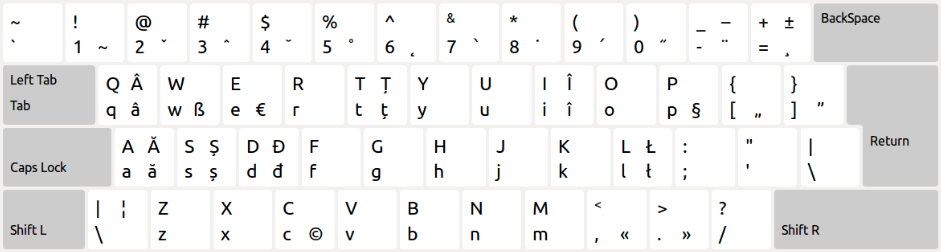
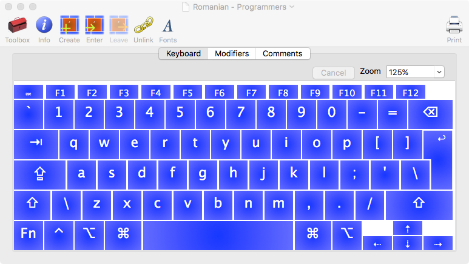
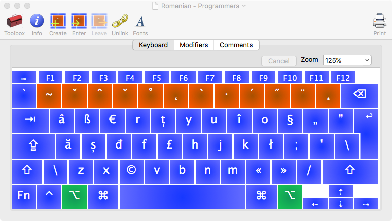

## Despre

Aranjament de tastatură "Romanian - Programmers" pentru Mac OS X / macOS. Proiect implementat folosind [Ukelele](http://scripts.sil.org/cms/scripts/page.php?site_id=nrsi&id=ukelele) conform [SR 13392:2004](http://www.secarica.ro/kbdro_help_romanian_standard_ro.pdf).

Aranjamentul este împachetat ca `Romanian - Programmers.bundle`. Metadata bundle-ului declară limba română (`TISIntendedLanguage = ro`), astfel încât macOS îl afișează în secțiunea **Romanian**, nu în **Others**. Pe macOS 12.4 și mai nou, instalatorul folosește o iconiță `RO` în stilul macOS; pe versiunile mai vechi folosește un steag românesc generat programatic.

Pe scurt:

* `ALT + a` &rarr; _ă_
* `ALT + q` &rarr; _â_
* `ALT + i` &rarr; _î_
* `ALT + s` &rarr; _ș_
* `ALT + t` &rarr; _ț_

Extensie non-standard:

* `ALT + g` &rarr; £ - disponibilă în ramura [non-standard/uk](https://github.com/SaltwaterC/romanian-programmers-mac/tree/non-standard/uk)

Imaginea de ansamblu a aranjamentului:



Aranjamentul implicit fără a apăsa taste de modificare:



Aranjamentul cu tasta de modificare ALT:



Implementarea este completă, însă prezintă următoarea deficiență: ambele taste ALT (option) au rolul de AltGr. AltGr este interpretată drept CTRL + ALT, dacă această tastă există. Apple nu are AltGr pe tastaturile proprii. Combinațiile s-ar complica într-un mod inutil pentru aproduce același rezultat. Din moment ce din punct de vedere hardware, tastele sunt identice, `rightOption` în loc de `anyOption` nu se poate folosi. Această deficiență nu poate fi rezolvată pentru o tastatură Apple.

## Instalare / Actualizare

Instalarea implicită este per-user: bundle-ul este copiat în `~/Library/Keyboard Layouts`, fără `sudo` și fără să fie nevoie să deschizi manual directorul ascuns `Library` în Finder. Scriptul nu adaugă și nu activează automat nicio sursă de input și nu editează preferințele macOS.

Dintr-un checkout local:

```bash
make install
```

Pentru instalarea system-wide, disponibilă tuturor utilizatorilor computerului:

```bash
make install-system
```

Aceasta instalează în `/Library/Keyboard Layouts` și solicită parola de administrator.

Dezinstalare:

```bash
make uninstall          # per-user, implicit
make uninstall-system   # system-wide
make reinstall          # curăță starea per-user și reinstalează
```

Dezinstalarea per-user elimină bundle-ul și fișierele vechi ale layout-ului. Dacă Input Sources era deja deschis, închide-l și redeschide-l după instalare sau dezinstalare.

După `make install`, deschide System Settings > Keyboard > Input Sources, apasă `+`, alege **Romanian** și apoi **Romanian - Programmers**, apoi apasă `Add`. Pe versiunile vechi: System Preferences > Keyboard > Input Sources. Astfel macOS gestionează singur adăugarea și selecția sursei.

`make reinstall` elimină bundle-ul și îl copiază din nou; adăugarea sursei rămâne o operație explicită în System Settings.

Scripturile pot fi folosite și direct:

```bash
curl --silent --location --max-redirs 10 https://raw.githubusercontent.com/SaltwaterC/romanian-programmers-mac/master/install.sh --output "/tmp/rpm-install.sh" && bash "/tmp/rpm-install.sh" && rm -f "/tmp/rpm-install.sh"
```

Comanda de mai sus instalează per-user. Pentru instalare system-wide, adaugă `--system` după script: `bash "/tmp/rpm-install.sh" --system`.

În timpul dezvoltării, `./install.sh local` folosește fișierele din checkout-ul curent și instalează per-user; pentru varianta system-wide se folosește `./install.sh local --system`.

**Atenție!**

 * pe macOS 12.4+, iconița `RO` este o mască template lată, cu reprezentări mici legacy pentru meniul din bara de meniu și variante mari pentru System Settings; macOS îi adaptează culorile în funcție de context. Steagul pentru versiunile anterioare este generat de același script (`make icons`), fără asset extern.
 * instalarea per-user nu invocă `sudo`. Scriptul folosește `sudo` doar dacă este rulat cu `--system`; pentru siguranță, este recomandată inspectarea scriptului înainte de rularea lui.
